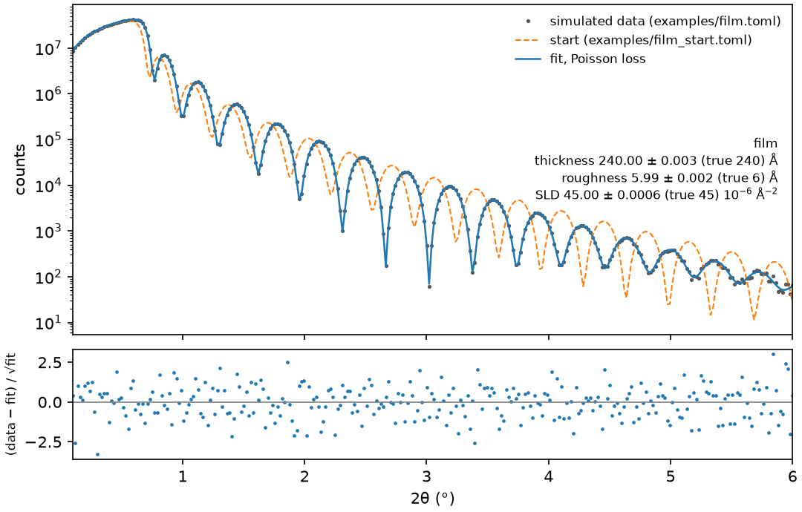
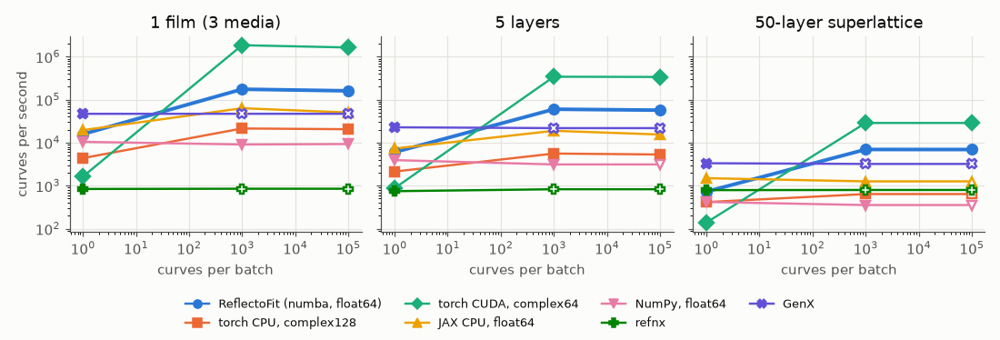

# ReflectoFit

[한국어](README.ko.md)

[](https://github.com/NaNIsaac/ReflectoFit/actions/workflows/ci.yml) [](LICENSE)



A fast X-ray reflectivity fitting engine and command line: layer models, an instrument model, least
squares, differential evolution and MCMC, model selection, and fit reports.

It is for anyone with a measured specular XRR curve of a thin film who wants the thickness, roughness
and density of each layer. The forward model is a float64 Parratt recursion (compiled with numba)
with Névot-Croce roughness, Gaussian resolution, beam footprint, Cu Kα₂ and a 2θ offset; it agrees
with refnx to 1e-10. A torch backend gives the same curves with gradients. The forward physics
lives in [ReflectoSim](https://github.com/NaNIsaac/ReflectoSim), which also generates synthetic XRR
data for machine learning; ReflectoFit is the inverse problem on top of it.

Status: early development. The design is in [`docs/DESIGN.md`](docs/DESIGN.md); model selection
follows.



Forward-model throughput on the benchmark machine (`docs/design-bench/throughput.json`, DESIGN.md section 5). The numba backend computes about 57 000 five-layer curves per second in batches of 100 000 on CPU; hollow markers are values scaled or extrapolated from a smaller batch.

## Install

<!-- test -->
```sh
pip install reflectofit
```

This also installs [ReflectoSim](https://github.com/NaNIsaac/ReflectoSim), which holds the forward
physics. Optional extras: `reflectofit[torch]` adds the differentiable torch forward and
`reflectofit[mcmc]` adds emcee for the sampler. Without them neither torch nor emcee is installed.

To work on the package, or to run the examples below, clone it and use [uv](https://docs.astral.sh/uv/):

```sh
git clone https://github.com/NaNIsaac/ReflectoFit
cd ReflectoFit
uv sync
```

## First run

Simulate a measured curve of a 240 Å film on SiO₂ on Si with Poisson counts, then fit it from a wrong
starting guess:

<!-- test -->
```sh
uv run reflectofit calc --model examples/film.toml --counts 1e8 -o film.dat
uv run reflectofit fit film.dat --model examples/film_start.toml --loss poisson --counts-scale 1e8 -o fit
```

The fit prints each free parameter with its standard error and writes `fit/result.json`,
`fit/model.toml` (the fitted model, reusable as a start) and `fit/fitted.dat`.

Model files, every command and the Python API: [docs/usage.md](docs/usage.md).

## Documentation

- [docs/usage.md](docs/usage.md): the model files, every command and the Python API in full.
- [docs/DESIGN.md](docs/DESIGN.md): the design, the API and the engine choice, with the forward-model benchmark behind the figure above (`docs/design-bench/throughput.json`).

## Models

A model is a TOML file: the instrument, the layers from the top, the substrate, and the free
parameters with their bounds.

```toml
[instrument]
wavelength = 1.5406    # Å
i0 = 1.0
background = 3e-8
sigma_q = 5e-4         # Gaussian resolution σ in q [Å⁻¹]; dq_over_q adds a term ∝ q
sample_length = 10.0   # mm, with beam_sigma (mm) for the footprint
beam_sigma = 0.04

[[layer]]
name = "film"
sld = [45.0, 1.5]      # 1e-6 Å⁻², [real, imaginary]; imaginary > 0 is absorption
thickness = 240.0      # Å
roughness = 6.0        # Å, of the interface above this layer

[[layer]]
name = "oxide"
material = "SiO2"      # or give the SLD from composition and density
density = 2.20         # g/cm³
thickness = 12.0
roughness = 3.0

[substrate]
material = "Si"
density = 2.33
roughness = 3.0

[fit]
"film.thickness" = [150.0, 350.0]
"film.sld" = [20.0, 80.0]
i0 = [0.5, 2.0]
log10_background = [-10.0, -5.0]
```

Free parameters: `<layer>.thickness`, `.roughness`, `.sld` and `.isld` for each named layer and
for `substrate`; the instrument terms `i0`, `background`, `log10_background`, `tth_offset`,
`sigma_q`, `dq_over_q`, `kalpha2_ratio`, `sample_length` and `beam_sigma`.

## Command line

| Command | What it does |
|---|---|
| `reflectofit calc --model M -o out.dat` | The model curve on a grid (`--grid tth:0.1:6:300`), with Poisson counts if asked |
| `reflectofit fit data.dat --model M` | Least squares (`--method lsq`, `--trust 0.2` limits each start to ±20 %) or differential evolution (`--method de`); loss `log`, `raw`, `poisson` or `chi2` |
| `reflectofit score data.dat --model M` | Every loss the data allow, and AIC and BIC for the likelihood losses |
| `reflectofit stitch 1.dat 2.dat -o all.dat` | Join scans measured through different attenuators (`--method boundary` or `median`) |

A data file is text: 2θ in degrees (or q in Å⁻¹ with `--x q`), the intensity, and optionally an
error column. With `--counts-scale S` the intensity is read as counts at R = 1 with S counts; the
Poisson loss needs it.

## Python

The forward model is [ReflectoSim](https://github.com/NaNIsaac/ReflectoSim)'s:

```python
import numpy as np
from reflectosim import Instrument, Layer, Stack, forward, materials, tth_to_q

stack = Stack(
    [Layer(45 + 1.5j, 240, 6, "film"), Layer(materials.sld("SiO2", 2.20), 12, 3, "oxide")],
    Layer(materials.sld("Si", 2.33), roughness=3),
)
q = tth_to_q(np.linspace(0.1, 6, 300))
r = forward(q, stack, Instrument(sigma_q=5e-4, background=3e-8))
r_torch = forward(q, stack, backend="torch")  # differentiable, needs the torch extra
```

## Development

```sh
uv run pytest
```

## License

MIT
